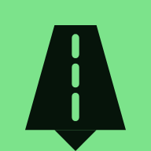
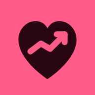
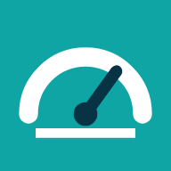
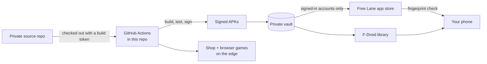

<picture><source media="(prefers-color-scheme: light)" srcset="profile/readme/img/banner-light.svg"></picture>

# Android apps and games by Frantz Vardman

**Free with one account.** Sign in once at the shop and every app, update and purchase follows you. Private by default: no trackers, no ads from strangers. 
Try the games in your browser first, no sign-up: **[Giants & Guns](https://shop.frantzmichaelsthilairevardman.com/giants/)** (now with Siege mode) · **[Bombs & Bullion](https://shop.frantzmichaelsthilairevardman.com/play/)** · **[Monkey Money](https://shop.frantzmichaelsthilairevardman.com/monkey/)** · **[Cave Hunt](https://shop.frantzmichaelsthilairevardman.com/cave/)**

<table>
<tr><td align="center" width="25%"> <b>Free Lane</b> My own app store: one-tap installs and automatic updates <a href="https://shop.frantzmichaelsthilairevardman.com/get/freelane?ref=github">Get it</a></td><td align="center" width="25%"> <b>Own It</b> Contracts, royalties and shows for independent artists <a href="https://shop.frantzmichaelsthilairevardman.com/get/ownit?ref=github">Get it</a></td><td align="center" width="25%"> <b>Lovly</b> Credit repair you do yourself, letters that cite the law <a href="https://shop.frantzmichaelsthilairevardman.com/get/lovly?ref=github">Get it</a></td><td align="center" width="25%"> <b>Reclaim</b> Name and privacy defense: evidence, takedowns, help <a href="https://shop.frantzmichaelsthilairevardman.com/get/reclaim?ref=github">Get it</a></td></tr>
<tr><td align="center" width="25%"> <b>Safe to Spend</b> What&#x27;s safe to spend until payday, offline <a href="https://shop.frantzmichaelsthilairevardman.com/get/safetospend?ref=github">Get it</a></td><td align="center" width="25%"> <b>Safe Pocket</b> Encrypted pocket for your ID and papers (EN/ES/HT) <a href="https://shop.frantzmichaelsthilairevardman.com/get/safepocket?ref=github">Get it</a></td><td align="center" width="25%"> <b>Signal Fire</b> Chat and help nearby with no cell service <a href="https://shop.frantzmichaelsthilairevardman.com/get/signalfire?ref=github">Get it</a></td><td align="center" width="25%"> <b>Clear Check</b> A plain-English check-up for your business <a href="https://shop.frantzmichaelsthilairevardman.com/get/clearcheck?ref=github">Get it</a></td></tr>
<tr><td align="center" width="25%"> <b>Pure Beats</b> 100% original beats on your phone, with stems <a href="https://shop.frantzmichaelsthilairevardman.com/get/purebeats?ref=github">Get it</a></td><td align="center" width="25%"> <b>Rex Voice</b> On-device voice cloning with spoken consent <a href="https://shop.frantzmichaelsthilairevardman.com/get/rexvoice?ref=github">Get it</a></td><td align="center" width="25%"> <b>Lead Hunter</b> Homeowner leads for roofing and window reps <a href="https://shop.frantzmichaelsthilairevardman.com/get/leadhunter?ref=github">Get it</a></td><td align="center" width="25%"> <b>Vindie News</b> Every new app, game and drop, as an app <a href="https://shop.frantzmichaelsthilairevardman.com/get/vindienews?ref=github">Get it</a></td></tr>
<tr><td align="center" width="25%"> <b>Bombs &amp; Bullion</b> Arcade game: catch the gold, dodge the bombs <a href="https://shop.frantzmichaelsthilairevardman.com/get/crownrush?ref=github">Get it</a> · <a href="https://shop.frantzmichaelsthilairevardman.com/play/">Play</a></td><td align="center" width="25%"> <b>Giants &amp; Guns</b> Side-view shooter, plus Siege mode (tower defense) <a href="https://shop.frantzmichaelsthilairevardman.com/get/giants?ref=github">Get it</a> · <a href="https://shop.frantzmichaelsthilairevardman.com/giants/">Play</a></td><td align="center" width="25%"> <b>Monkey Money</b> beta A genius monkey with a banana blaster, 10 stages <a href="https://shop.frantzmichaelsthilairevardman.com/get/monkey?ref=github">Get it</a> · <a href="https://shop.frantzmichaelsthilairevardman.com/monkey/">Play</a></td><td align="center" width="25%"> <b>Cave Hunt</b> beta Riddles, torches and a village to build <a href="https://shop.frantzmichaelsthilairevardman.com/get/cave?ref=github">Get it</a> · <a href="https://shop.frantzmichaelsthilairevardman.com/cave/">Play</a></td></tr>
</table>

Get them all, with automatic updates, through **[Free Lane](https://shop.frantzmichaelsthilairevardman.com/apps/freelane)**, my own app store. 📰 New releases first: **[Vindie News](https://shop.frantzmichaelsthilairevardman.com/news/)** · 🛍 **[Frantz Vardman Shop](https://shop.frantzmichaelsthilairevardman.com/)**

App files are kept in a private vault and handed out only to signed-in accounts, so this repo holds the build setup, not the apps themselves.

**Contents:** [How it's built](#how-its-built) · [Quality checks](#quality-checks) · [Privacy policies](#privacy-policies) · [Own It](#own-it-the-music-business-app) · [Safe to Spend](#safe-to-spend-payday-planner) · [Install](#how-to-install) · [Security](SECURITY.md)

## How it's built

- **One private codebase for every app and game.** "Auto build" checks the private code every hour and rebuilds only what changed.
- **Signed and verified.** Each app has its own release key; Free Lane checks every download's fingerprint before it installs.
- **No trackers inside.** No third-party analytics or ad SDKs in any app. Update checks send only the app's name.
- **Your data stays yours.** Most apps work fully offline; anything synced goes to your own account, never to a data broker.

## Quality checks

| Check | What it does | Runs |
|---|---|---|
| [Hourly game tests](https://github.com/frantzvardman26-max/ownit-app/actions/workflows/prism-watch.yml) | A robot plays every browser game with fresh random taps and flags layout, rules and score bugs | every hour |
| [Emulator smoke test](https://github.com/frantzvardman26-max/ownit-app/actions/workflows/smoke-test.yml) | Installs the published apps on a real Android emulator, opens each one and catches crashes | after releases |
| [Auto build](https://github.com/frantzvardman26-max/ownit-app/actions/workflows/auto-build.yml) | Builds only the apps whose code changed, plus unit and screen tests | every hour |
| [Shop deploy](https://github.com/frantzvardman26-max/ownit-app/actions/workflows/shop-verify.yml) | Builds the shop, checks every product and link, then deploys | on every change |

## Privacy policies

Every app has a plain-English policy: [Own It](PRIVACY.md) · [Free Lane](FREE_LANE_PRIVACY.md) · [Lovly](LOVLY_PRIVACY.md) · [Reclaim](RECLAIM_PRIVACY.md) · [Safe to Spend](SAFE_TO_SPEND_PRIVACY.md) · [Safe Pocket](SAFE_POCKET_PRIVACY.md) · [Signal Fire](SIGNAL_FIRE_PRIVACY.md) · [Clear Check](CLEAR_CHECK_PRIVACY.md) · [Pure Beats](PURE_BEATS_PRIVACY.md) · [Rex Voice](REX_VOICE_PRIVACY.md) · [Lead Hunter](LEAD_HUNTER_PRIVACY.md) · [Vindie News](VINDIE_NEWS_PRIVACY.md) · [Bombs & Bullion](CROWN_RUSH_PRIVACY.md) · [Giants & Guns](GIANTS_GUNS_PRIVACY.md) · [Cave Hunt](CAVE_HUNT_PRIVACY.md) · [Monkey Money](MONKEY_MONEY_PRIVACY.md) · [Vindie VPN](VINDIE_VPN_PRIVACY.md) · [Palm Distribute](PALM_DISTRIBUTE_PRIVACY.md) · [Vindie Ads](VINDIE_ADS_PRIVACY.md)

Want to test new apps first? **[Apply to the beta](https://shop.frantzmichaelsthilairevardman.com/test/)**.

Own It and Safe to Spend are described below.

---

## Own It: the music business app

The free business app for independent artists, producers and managers.

- **Know your deal:** scan a contract (PDF, Word, photo or screenshot) for red flags in plain English, with a counter-offer you can send
- **Get paid:** track songs, splits, PRO, MLC, SoundExchange and ISRC registrations; split payments with collaborators; check royalty statements
- **Run the business:** invoices, shows, income and expenses, tax set-aside with quarterly reminders, split sheets and agreements you can sign on your phone
- **Sell and get seen:** your own store linked to your own checkout, promo graphics, a fan list, a press kit (EPK), release countdowns, and a free listing in the Own It Artists directory
- **For managers:** a roster with commission, contract dates and each artist's songs, shows and money

Everything stays on your phone, with app lock and automatic backup. English and Spanish.

**[Download Own It for Android](https://shop.frantzmichaelsthilairevardman.com/get/ownit?ref=github)** · [Privacy policy](PRIVACY.md)

Own It provides legal information and tools, not legal advice.

## Safe to Spend: payday planner

Know exactly what's left until your next paycheck. Safe to Spend turns your cash, paycheck, bills, debt minimums and subscriptions into one honest number, and shows every item that went into it.

- Safe-to-spend amount, days left and a per-day amount
- Bills, debts and subscriptions with due-date reminders
- A day-by-day timeline that shows your lowest point before it happens
- No bank login and no internet access at all. Back up to a password-locked file.

**[Download Safe to Spend for Android](https://shop.frantzmichaelsthilairevardman.com/get/safetospend?ref=github)** · [Privacy policy](SAFE_TO_SPEND_PRIVACY.md)

## How to install

1. Tap the download link on your Android phone and sign in with your free account (it takes a minute to make one).
2. Open the downloaded file. If Android asks, allow installs from your browser or Files app.
3. Tap **Install**.

Updates: install [Free Lane](https://shop.frantzmichaelsthilairevardman.com/apps/freelane) and every app stays up to date by itself. Your data stays when you update.

## More tools

Planners, templates and guides: **[shop.frantzmichaelsthilairevardman.com](https://shop.frantzmichaelsthilairevardman.com)**

## Builds

The apps are built here by GitHub Actions (free for public repositories). The source code stays private: builds
check it out with the `BUILD_TOKEN` secret, and only the finished apps are published on this page.
"Auto build" checks for code changes every hour and builds just the apps that changed.

---
© 2026 Frantz Vardman. All rights reserved. See [LICENSE](LICENSE). Apps marked BETA are free to test and not for sale.
